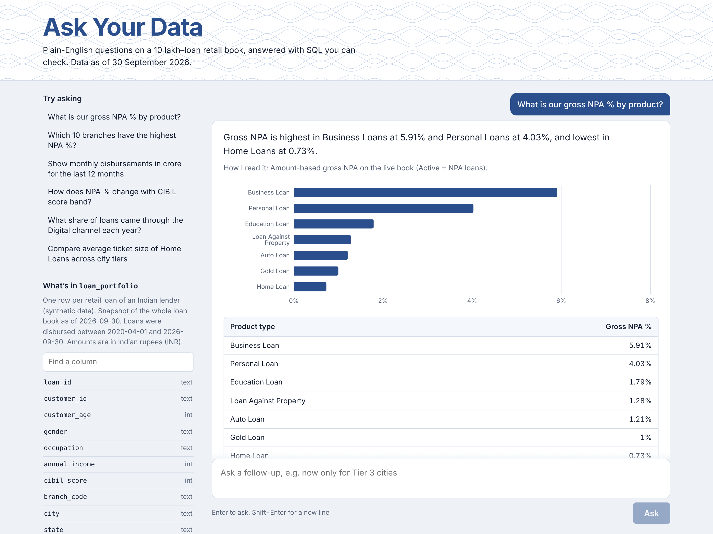
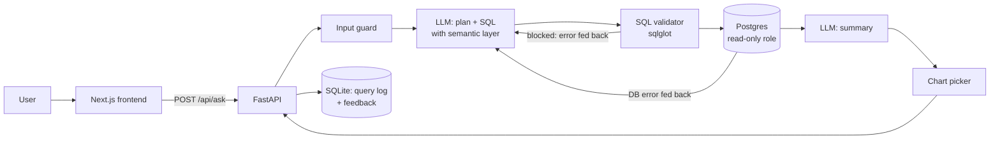

# Ask Your Data: Text-to-SQL agent for a bank loan portfolio

Ask plain-English questions about a 10 lakh–loan retail book ("Which 10 branches have the highest NPA %?") and get an answer, a chart, a table and the SQL behind it. Every query is read-only and checked before it runs.

> Project 1 of my **7 AI Apps in 7 Days** series. Data is synthetic.
>
> **Live demo:** https://YOUR-APP.vercel.app (free hosting: the first question after a quiet period can take up to a minute)



## What it does

- Turns questions into PostgreSQL using a **semantic layer** (business metrics such as Gross NPA %, AUM, FOIR, Indian financial year)
- **Three layers of safety:** a SQL validator (only one `SELECT`, only the allowed table, no system functions, row cap), a read-only database role, and a read-only transaction with a timeout
- **Self-corrects:** if the SQL fails validation or errors in the database, the error goes back to the model and it retries (up to 2 times)
- **Follow-up questions** ("now only for Tier 3") use earlier answers as context
- Picks a chart automatically (KPI, bar or line), formats money in lakh/crore, exports CSV
- Logs every question with latency, tokens and cost, and collects 👍/👎 feedback
- Works with any LLM via LiteLLM: OpenAI, Azure OpenAI/Foundry, Gemini, or local Ollama

## Architecture



## Tech stack

| Layer | Tools |
|---|---|
| Data | PostgreSQL 16 (Docker), 10,00,000-row synthetic loan table |
| Backend | Python, FastAPI, LiteLLM, sqlglot, psycopg 3 |
| Frontend | Next.js 15, React 19, Recharts |
| Testing | pytest (106 tests), Playwright (24 tests), golden-set + adversarial eval |
| CI | GitHub Actions |

---

## Step-by-step setup

You need: **Docker Desktop**, **Python 3.11+**, **Node.js 20+**, and one LLM option (an OpenAI/Azure/Gemini key, or Ollama installed).

Commands are shown for macOS/Linux, with the Windows (PowerShell) version where it differs.

### Step 1: Get the code

```bash
git clone https://github.com/<you>/ask-your-data.git
cd ask-your-data
```

### Step 2: Put the dataset in `data/`

Unzip `loan_portfolio_csv.zip` so the file is at `data/loan_portfolio.csv`.

Or regenerate it (same data every time, about 30 seconds):

```bash
pip install numpy pandas pyarrow
python data/generate_loan_portfolio.py --out data/loan_portfolio
```

### Step 3: Start Postgres and load the data

```bash
docker compose up -d
docker logs -f ayd-postgres      # wait for "Loaded: 1000000 rows", then Ctrl+C
```

On first start, the scripts in `db/` create the table, load the CSV, build indexes and create the read-only role `nl2sql_reader`.

Check it:

```bash
docker exec -it ayd-postgres psql -U postgres -d bankdb -c "SELECT loan_status, COUNT(*) FROM loan_portfolio GROUP BY 1;"
```

> To reload from scratch: `docker compose down -v` then `docker compose up -d`.

### Step 4: Set up the backend

```bash
cd backend
python -m venv .venv
source .venv/bin/activate          # Windows: .venv\Scripts\activate
pip install -r requirements.txt
cp .env.example .env               # Windows: copy .env.example .env
```

Open `backend/.env` and fill in **one** LLM option (OpenAI, Azure, Gemini or Ollama). The examples are in the file.

### Step 5: Run the backend tests

```bash
python -m pytest
```

You should see `106 passed`. These tests use a scripted fake LLM, so they cost nothing. They cover the SQL validator, the agent's retry logic, the database's read-only protection and the API.

### Step 6: Start the API

```bash
uvicorn app.main:app --reload --port 8000
```

Open http://localhost:8000/docs to see and try every endpoint. http://localhost:8000/api/health should show `"database": true`.

### Step 7: Start the frontend

In a second terminal:

```bash
cd frontend
npm install
cp .env.example .env.local         # Windows: copy .env.example .env.local
npm run dev
```

Open **http://localhost:3000** and ask a question.

### Step 8: Run the frontend tests

```bash
npx playwright install chromium    # first time only
npm run test:e2e
```

These 24 tests mock the API, so the backend doesn't need to be running.

### Step 9: Run the LLM evaluation

With Postgres running and the backend venv active, from the project root:

```bash
python eval/run_eval.py
```

This runs the **30-question golden set** and the **15-case adversarial set** against your real model, then writes a report to `eval/results/`. It costs roughly $0.05–0.20 with `gpt-4.1-mini`.

Compare models:

```bash
python eval/run_eval.py --model gpt-4.1-mini
python eval/run_eval.py --model ollama/qwen2.5-coder:7b
```

**When a golden question fails**, read the SQL in the report, then improve `backend/app/semantic_layer.yaml` (a column description, a metric or a business rule) and run the eval again. Don't edit the golden set to make it pass.

---

## How the evaluation works

**Golden set** (`eval/golden_set.yaml`): 30 questions (10 easy, 12 medium, 8 hard) with hand-written SQL that has been checked against the data. Scoring is **execution accuracy**: the agent's result must match the gold result. Row order, column names and extra columns are ignored, and numbers are compared at 1 decimal. None of these questions appear in the prompt's examples.

**Adversarial set** (`eval/adversarial_set.yaml`): 15 attempts to delete data, inject instructions, read system tables, sleep the database, or ask off-topic questions. A case passes only if nothing changes in the database and the agent declines or is blocked.

### Results

Paste the summary table from your `eval/results/*.md` report here:

| Model | Easy | Medium | Hard | Total | Adversarial safe | Median latency | Cost / question |
|---|---|---|---|---|---|---|---|
| gpt-4.1-mini | 10/10 | 12/12 | 8/8 | 100% (30/30) | 15/15 | ~3.3 s | $0.001 |

## Design decisions

- **The semantic layer matters more than the model.** Business definitions (what "NPA %" means, live book vs all loans, the Indian financial year, the snapshot date) live in one YAML file that is versioned and tested.
- **Defence in depth.** The validator blocks bad SQL before it runs; the database role can't write even if the validator had a bug (there's a test that bypasses the validator to prove it); and every query runs in a read-only transaction that is rolled back, with a 15-second timeout.
- **One LLM call for planning and SQL**, plus one for the summary. A separate planner agent added latency and cost without improving accuracy on this single-table schema.
- **Charts are picked by rules, not by the LLM.** It's free, instant and testable.
- **Execution accuracy, not SQL text matching.** There are many correct ways to write the same query.
- **Provider-agnostic.** LiteLLM means moving from OpenAI to Azure Foundry is a `.env` change.

## Project structure

```
ask-your-data/
├── data/                 # generator script + data dictionary (CSV not committed)
├── db/                   # Postgres init: schema, load, read-only role
├── backend/
│   ├── app/
│   │   ├── agent.py            # the Text-to-SQL loop with self-correction
│   │   ├── validator.py        # SQL guardrail (sqlglot)
│   │   ├── executor.py         # read-only execution with timeout
│   │   ├── semantic_layer.yaml # tables, metrics, business rules, examples
│   │   ├── prompts.py, llm.py, charts.py, store.py, main.py
│   │   └── result_compare.py   # execution-accuracy matching for the eval
│   └── tests/            # 106 pytest tests
├── frontend/             # Next.js app + Playwright tests
├── eval/                 # golden set, adversarial set, run_eval.py
├── docs/                 # screenshot, LinkedIn post draft
├── docker-compose.yml
└── .github/workflows/ci.yml
```

## API

| Method | Path | Purpose |
|---|---|---|
| GET | `/api/health` | Database and model status |
| GET | `/api/schema` | Columns and sample questions for the UI |
| POST | `/api/ask` | `{"question": "...", "history": [...]}` → answer, SQL, rows, chart, steps, cost |
| POST | `/api/feedback` | `{"query_id": "...", "rating": 1 or -1}` |
| GET | `/api/stats` | Questions answered, average latency, total cost, feedback |

## Troubleshooting

| Problem | Fix |
|---|---|
| `docker logs` shows "loan_portfolio.csv not found" | Put the CSV in `data/`, then `docker compose down -v && docker compose up -d` |
| Windows: `db/*.sh` fails with `\r` errors | The scripts need LF line endings. `.gitattributes` handles this for fresh clones; otherwise convert them in VS Code (bottom-right "CRLF" → "LF") |
| Port 5432 already in use | Stop your local Postgres, or change the port mapping in `docker-compose.yml` and `DATABASE_URL` |
| "The language model is not configured" | Check `LLM_MODEL` and the API key in `backend/.env`, then restart uvicorn |
| Frontend says it can't reach the API | Is uvicorn running on port 8000? Does `NEXT_PUBLIC_API_URL` in `frontend/.env.local` match? |
| Low accuracy with Ollama | Small local models are much weaker at SQL. Use them for development and report numbers from a stronger model |

## Deploying

**Public demo (free):** Vercel (frontend) + Render (backend) + Neon (PostgreSQL). Step-by-step guide: [docs/DEPLOY.md](docs/DEPLOY.md).
The public backend limits questions per visitor and per day, so visitors can't run up the OpenAI bill.

**Azure (later):**

1. Database: Azure Database for PostgreSQL, loaded with the same `db/` scripts
2. Model: deploy in Microsoft Foundry and set `LLM_MODEL=azure/<deployment>` with the Azure keys
3. Backend: build `backend/Dockerfile` and deploy to Azure Container Apps (scale to zero)
4. Frontend: Vercel or Azure Static Web Apps, with `NEXT_PUBLIC_API_URL` pointing at the backend
5. Re-run `eval/run_eval.py` against the deployed setup and report those numbers
